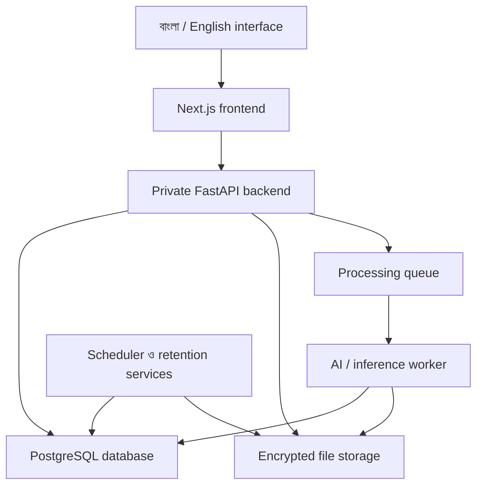

# Mouchak AI · মৌচাক এআই

**Central AI Platform for Bangladesh**

মৌচাক এআই বাংলাদেশের দৈনন্দিন কাজের জন্য তৈরি একটি কেন্দ্রীয় বাংলা–ইংরেজি সহায়ক প্ল্যাটফর্ম। কৃষি, শিক্ষা, স্বাস্থ্যসংক্রান্ত নথি, ব্যবসা, বাজার, বাসাবাড়ি ও নাগরিক সেবার বিভিন্ন প্রয়োজনকে এক জায়গায় আনতে এর ক্যাটালগে ৫০টি বিষয়ভিত্তিক tool workspace সাজানো হয়েছে।

প্রতিটি টুলের নিজস্ব পরিচিতি, লোগো ও কাজের জায়গা রয়েছে। একই navigation, ভাষা নির্বাচন, ব্যক্তিগত session এবং কেন্দ্রীয় প্রশাসনিক ব্যবস্থার মাধ্যমে পুরো প্ল্যাটফর্ম ব্যবহার করা যায়।

## কার জন্য

সাধারণ ব্যবহারকারী, শিক্ষার্থী, ছোট ব্যবসায়ী, কৃষক, পরিচর্যাকারী এবং নাগরিক সেবা নিতে আগ্রহী মানুষের জন্য মৌচাক এআই। নিজের তথ্য, নথি, পর্যবেক্ষণ ও হিসাব গুছিয়ে কাজের উপযোগী ফলাফল তৈরি করাই এর মূল উদ্দেশ্য।

## কীভাবে কাজ করে

1. **কাজের টুল বেছে নিন।** বিষয়ভিত্তিক বিভাগ বা প্রয়োজন লিখে অনুসন্ধানের মাধ্যমে workspace খুলুন।
2. **তথ্য দিন ও যাচাই করুন।** সংশ্লিষ্ট ফর্মে লেখা, সংখ্যা বা উপযুক্ত ফাইল দিন এবং প্রক্রিয়াকরণের সম্মতি জানান।
3. **ফলাফল দেখুন ও ব্যবহার করুন।** টুল অনুযায়ী হিসাব, পর্যালোচনার নোট, সূত্রসহ উত্তর বা checklist দেখুন। প্রয়োজনমতো ফলাফল আবার খুলুন বা export করুন।

প্রতিটি workspace-এর কাজ অনুযায়ী AI model, সূত্রভিত্তিক retrieval অথবা নির্দিষ্ট হিসাবের ইঞ্জিন ব্যবহৃত হয়।

## প্ল্যাটফর্মে যা আছে

| অংশ | কাজ |
|---|---|
| **Home ও Explore** | বিভাগভিত্তিক টুল ক্যাটালগ, অনুসন্ধান ও প্রয়োজন অনুযায়ী টুল খোঁজা |
| **Tool workspace** | বিষয়ভিত্তিক ইনপুট, ফাইল প্রক্রিয়াকরণ, তথ্য যাচাই ও ফলাফল |
| **Session workspace** | নিজের সাময়িক কাজের ইতিহাস, ফলাফল আবার খোলা, export ও তথ্য ব্যবস্থাপনা |
| **বাংলা ও English interface** | ভাষা পরিবর্তন, বড় অক্ষরের সুবিধা, theme এবং পরিচিত navigation |
| **User-controlled processing** | কাজভিত্তিক সম্মতি, ব্যক্তিগত ফলাফল ও সংরক্ষিত তথ্যের নিয়ন্ত্রণ |
| **Super Admin ও operator console** | ভূমিকা অনুযায়ী কনটেন্ট, উৎস, টুল, মডেল ও প্রশাসনিক কার্যক্রম পরিচালনা |
| **Site Builder** | ব্র্যান্ড, লোগো, রং, menu, homepage, public page ও টুলের উপস্থাপনা সম্পাদনা |
| **Review ও publishing** | খসড়া, স্বতন্ত্র পর্যালোচনা, প্রকাশের সময়সূচি, rollback ও audit history |

## ৫০টি টুলের বিভাগ

নিচের তালিকায় প্ল্যাটফর্মের বিষয়ভিত্তিক tool catalogue দেখানো হয়েছে। প্রতিটি টুলের পরিচিতি ও ব্যবহারপদ্ধতি সংশ্লিষ্ট workspace-এ পাওয়া যায়।

| বিভাগ | টুল |
|---|---|
| **কৃষি ও প্রাণিসম্পদ** | PukurSOS AI, FasalLoss AI, AgroPrice Planner, LivestockCare Log, MatiSense BD |
| **পরিবেশ ও জলবায়ু** | NodiWatch AI, NoiseTrace AI, WasteWise BD, WaterGuard BD, HeatSafe BD, DrainPulse BD, JhorAlert BD |
| **বাসা ও দৈনন্দিন খরচ** | RoofWise AI, HomeHazard AI, RentalFair BD, BiddutPlan BD, RepairRight BD |
| **নাগরিক সেবা ও কর্মক্ষেত্র** | ChuktiShield AI, WorkSafe Vision AI, RoadFix BD, SafeRoute BD, CivicForm AI, LandLedger BD, WageGuard BD, ShebaQueue BD, OdhikarSetu BD |
| **বাজার ও ভোক্তা সহায়তা** | BillDetect AI, BazarCompare AI |
| **স্বাস্থ্যসংক্রান্ত নথি ও পরিচর্যা** | CareJourney AI, ClinicCompass BD, LabTrend BD, DoseClear BD, VaccinePath BD, MaternalRoute BD, DengueSignal BD, HospitalBillGuard BD, SafeBlood Connect BD, OshudhKhoj BD, FoodLabel Lens BD |
| **ব্যবসা ও হিসাব** | DokanLens AI, HishabBondhu BD |
| **শেখা ও শিক্ষা** | ShikkhaRAG BD, BanglaRead Coach, SkillBridge BD, SchoolRoute BD |
| **খেলাধুলা** | GoliCoach AI |
| **যোগাযোগে সহায়তা** | ShobdoSetu BD |
| **অগ্নিনিরাপত্তা** | AgunPath BD |
| **ডিজিটাল সচেতনতা** | ScamSignal BD |
| **যাতায়াত** | JatraPulse BD |

## AI ও তথ্য প্রক্রিয়াকরণ

মৌচাক এআইয়ের processing layer-এ বিভিন্ন ধরনের ইঞ্জিন একসঙ্গে কাজ করে:

- **নথি ও OCR:** বাংলা–ইংরেজি লেখা শনাক্তকরণ, বিলের editable draft এবং ব্যবহারকারীর যাচাই।
- **NLP ও RAG:** multilingual embeddings, keyword retrieval এবং উৎসের passage উল্লেখ করে তথ্য খোঁজা।
- **বাংলা পড়ার সহায়তা:** passage, comprehension, শব্দ চিহ্নিত করে অনুশীলন এবং পরীক্ষামূলক স্থানীয় speech transcription ও word alignment।
- **ছবি, অডিও ও ভিডিও:** ছবি তুলনার পরিসংখ্যান, audio signal analysis এবং পরীক্ষামূলক sound-event ও pose processing।
- **ব্যবসা ও দৈনন্দিন হিসাব:** বিল, stock, cashbook, unit conversion, খরচ ও scenario তুলনা।
- **পর্যালোচিত তথ্যের অনুসন্ধান:** উৎস, অনুমতি ও প্রকাশের ধাপ অনুসরণ করে directory এবং reference data পরিচালনা।

## প্রোজেক্টের architecture

একই monorepo-তে frontend, backend, database migrations, inference services, প্রশাসনিক ব্যবস্থা এবং deployment configuration রাখা হয়েছে। Browser-এর অনুরোধ frontend-এর একই origin দিয়ে private backend-এ পৌঁছায়। দীর্ঘ processing কাজ queue ও worker-এর মাধ্যমে পরিচালিত হয়।

| স্তর | প্রধান প্রযুক্তি ও দায়িত্ব |
|---|---|
| **Frontend** | Next.js, React ও TypeScript; কেন্দ্রীয় website, tool workspace ও প্রশাসনিক interface |
| **Backend ও API** | Python ও FastAPI; ইনপুট যাচাই, অনুমতি, processing এবং ফলাফল সরবরাহ |
| **AI ও processing** | ONNX Runtime, Tesseract, multilingual retrieval, Whisper ও বিষয়ভিত্তিক processing engine |
| **Database ও storage** | PostgreSQL, development-এর জন্য SQLite, private S3-compatible storage ও encryption |
| **Background services** | Inference worker, job queue, scheduled publishing এবং session data retention |
| **পরিচালনা** | Role-based access, MFA, review workflow ও audit trail |
| **Deployment** | Node/Python service এবং Docker configuration; সামঞ্জস্যপূর্ণ infrastructure-এ চালানোর ব্যবস্থা |

## কেন্দ্রীয় প্রশাসন

Super Admin ও অনুমোদিত operator-রা দায়িত্ব অনুযায়ী প্ল্যাটফর্ম পরিচালনা করেন। Content editor, dataset reviewer, model operator, module manager, support agent ও auditor-এর জন্য আলাদা permission boundary রয়েছে।

প্রশাসনিক কাজের মধ্যে রয়েছে website-এর উপস্থাপনা সম্পাদনা, কনটেন্ট পর্যালোচনা, উৎস ও data rights যাচাই, মডেলের অবস্থা দেখা, টুলের availability পরিচালনা এবং audit record পর্যালোচনা। গুরুত্বপূর্ণ প্রশাসনিক কাজে MFA ও নির্দিষ্ট review workflow ব্যবহৃত হয়।

## তথ্য ও গোপনীয়তা

ব্যক্তিগত কাজ session ও owner অনুযায়ী আলাদা রাখা হয়। ফাইল ও ফলাফলের জন্য encryption, access control এবং retention ব্যবস্থা রয়েছে। কাজের processing consent ও model training consent পৃথকভাবে বিবেচনা করা হয়। বাংলা speech পরীক্ষায় raw voice ও transcript অস্থায়ীভাবে প্রক্রিয়াকরণ করা হয়।

উৎস, dataset ও model-এর provenance এবং প্রযোজ্য licence আলাদা documentation-এ সংরক্ষিত রয়েছে।

## বিস্তারিত documentation

- [বাংলা ব্যবহারকারী নির্দেশিকা](docs/USER_GUIDE_BN.md)
- [প্রশাসনিক নির্দেশিকা](docs/ADMIN_GUIDE.md)
- [Site Builder](docs/SITE_BUILDER.md)
- [API reference](docs/API_REFERENCE.md)
- [Local preview ও development setup](docs/PREVIEW.md)
- [Deployment নির্দেশিকা](docs/DEPLOYMENT.md)
- [Data ও model provenance](docs/DATA_AND_MODEL_PROVENANCE.md)
- [উৎস ও third-party licence](THIRD_PARTY_NOTICES.md)
